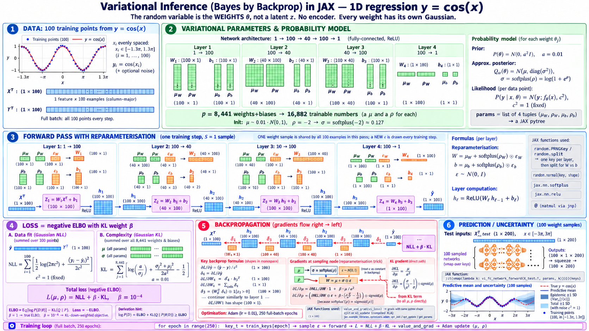
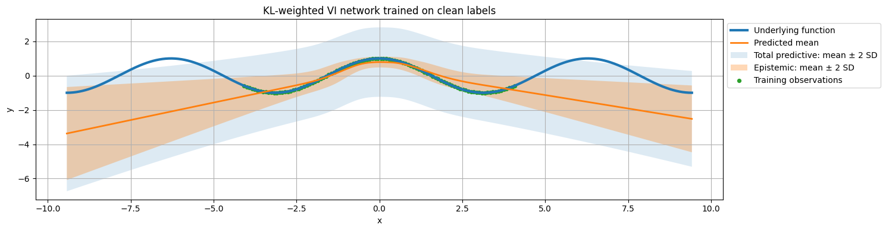
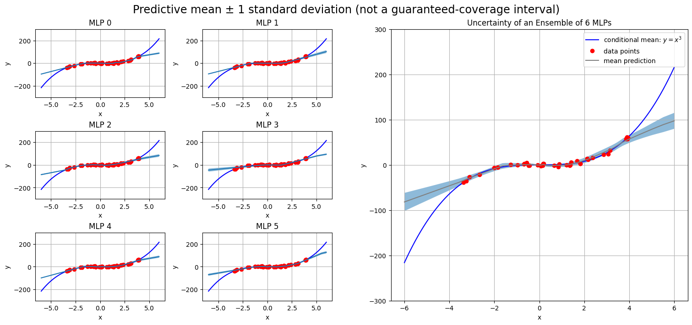
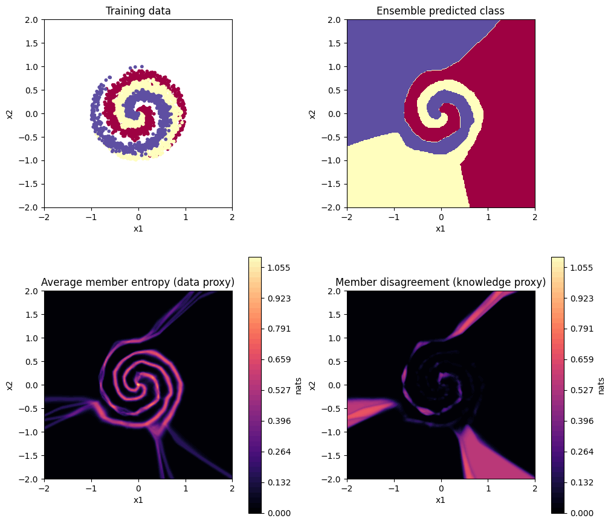
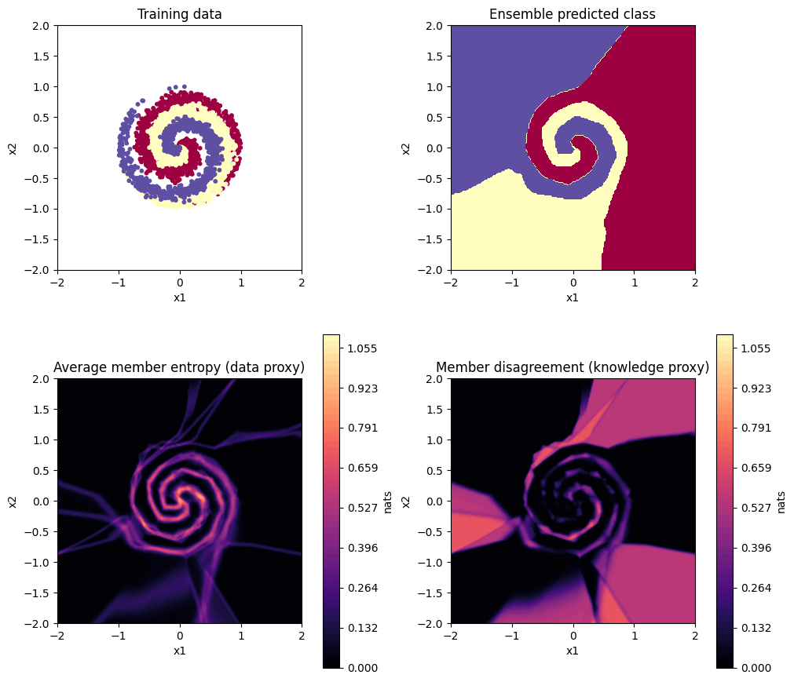

# Uncertainty Estimation in Deep Learning (JAX)

Ways to estimate how uncertain a neural network is, implemented from scratch in **JAX**: maximum-likelihood noise models, **Variational Inference (Bayes by Backprop)**, **Deep Ensembles** with adversarial training, and **MIMO** multi-head ensembles. I tested them on toy regression and classification problems and on MNIST.

> Practical assignment for **DD2412 Deep Learning, Advanced Course** at KTH Royal Institute of Technology. The course provided the notebook scaffolding and the toy datasets. I wrote the derivations, the model, loss and training code, the experiments and the analysis.

**Stack:** JAX 0.7.2 (`jax.numpy`, `grad`/`value_and_grad`, `jit`, `vmap`, `jax.example_libraries.optimizers`), NumPy, Matplotlib. Experiments ran on Kaggle (GPU for VI and MNIST, CPU for the toy ensembles).

---

## Contents

| Notebook | Topic |
|---|---|
| [`01_variational_inference_regression.ipynb`](notebooks/01_variational_inference_regression.ipynb) | Deterministic MLP vs. homoscedastic Gaussian MLE vs. **Bayes by Backprop** on 1-D `y = cos(x)` regression with clean, homoscedastic and heteroscedastic label noise |
| [`02_deep_ensembles_adversarial_training.ipynb`](notebooks/02_deep_ensembles_adversarial_training.ipynb) | **Deep Ensembles** (Lakshminarayanan et al., 2017): Gaussian/Laplace likelihoods for regression, 3-class spiral classification, and **FGSM** adversarial training |
| [`03_mimo_multi_head_ensembles.ipynb`](notebooks/03_mimo_multi_head_ensembles.ipynb) | **MIMO** (Havasi et al., 2021): several "subnetworks" that share one backbone, compared with deep ensembles |
| [`04_mnist_deep_ensembles.ipynb`](notebooks/04_mnist_deep_ensembles.ipynb) | Extension: a single classifier vs. a 3-member deep ensemble on **MNIST** |
| [`results/`](results/) | Saved metrics (JSON) behind the tables below |

---

## Concepts

- **Aleatoric uncertainty** is noise in the data itself, so more data does not reduce it. **Epistemic uncertainty** is the model's own uncertainty about its parameters. It should be larger far from the training data.
- **MLE with a likelihood model.** The network predicts the mean, and a learned log-scale `s` sets a Gaussian noise level `σ = exp(s)`. Training minimises the Gaussian NLL `½log(2πσ²) + (y − f(x))²/(2σ²)`, which captures *homoscedastic* (constant) aleatoric noise.
- **Variational Inference / Bayes by Backprop** (Blundell et al., 2015). Every weight gets its own Gaussian `q(θ) = N(μ, softplus(ρ)²)`. Training minimises the KL-weighted negative ELBO `Σᵢ NLL(yᵢ | f_θ(xᵢ)) + β · KL(q(θ) ‖ N(0, a²I))`. The **reparameterisation trick** `θ = μ + softplus(ρ) ⊙ ε` lets gradients flow to both `μ` and `ρ`. At test time, 100 networks are sampled with `vmap` to get the predictive mean and the epistemic spread.
- **Deep ensembles.** M independently initialised networks, each trained with a proper scoring rule. Their predictions are combined as a mixture.
  - Regression: total variance = *mean within-member variance* (aleatoric) + *variance of member means* (epistemic / disagreement).
  - Classification: predictive entropy `H[p̄]` = *mean member entropy* (data uncertainty) + *mutual information / disagreement* (knowledge uncertainty).
- **FGSM adversarial training** (Goodfellow et al., 2015). Each step averages the clean NLL with the NLL at `x + ε·sign(∇ₓ NLL)`, which makes predictions smoother around each training point.
- **MIMO.** The first and last layers are widened so that one network takes M inputs and makes M predictions in a single forward pass. During training, each slot gets an independently sampled example. At test time, the same input is repeated in every slot and the head outputs are averaged. This gives an ensemble almost for free (**22,800 + 753·M** parameters, compared with M × 23,553 for separate networks).

---

## Architecture

### Variational Inference (Bayes by Backprop)



- MLP **1 → 100 → 40 → 100 → 1** (ReLU): 8,441 weights and biases, so **16,882 variational parameters** (`μ`, `ρ` per weight).
- Prior `N(0, 0.01²)`, fixed observation variance `c² = 1`, KL weight `β = 10⁻⁴`, Adam (lr 0.01), full batch, one weight sample per step.

### Deep ensembles / MIMO / MNIST

| Model | Layers | Training |
|---|---|---|
| Ensemble regression (`y = x³ + noise`) | 1 → 10 → 6 → 30 → **2** (mean, scale) | M = 6 members, 600 full-batch updates each, Gaussian or Laplace NLL, ± FGSM |
| Ensemble classification (3-class spiral) | 2 → 150 → 150 → 3 | M = 4 members, 300 updates each, Adam (lr 0.1), L2 1e-3, ± FGSM |
| MIMO classification | 2M → 150 → 150 → 3M | M ∈ {1, 4, 8} heads, 2,000 shared-model updates |
| MNIST classifier | 784 → 150 → 150 → 10 | 3 members, 10 epochs, Adam (lr 1e-3), batch 256, 5k validation split |

---

## Results

### 1. Variational inference vs. deterministic and MLE models (`y = cos(x)`)

The training inputs lie in `[−1.3π, 1.3π]`. The test set covers `[−3π, 3π]`, so it measures both interpolation and extrapolation.

| Model / data | Result |
|---|---|
| Deterministic MLP, clean labels | interpolation MSE **0.000093**, extrapolation MSE **3.07**: almost perfect fit in the training range, no periodic extrapolation |
| Gaussian MLE, homoscedastic noise (true σ = 0.1) | learned **σ = 0.0936** (≈ 6 % below the true value) |
| Gaussian MLE, heteroscedastic noise (true σ = 0.2·\|cos x\|) | one shared **σ = 0.137**: too wide near the zeros of cos x and too narrow at its peaks. One shared scale cannot capture noise that varies with x |
| Bayes by Backprop | epistemic band is narrow on the data and widens steadily outside the training range (figure below) |



### 2. Deep ensembles: regression (`y = x³`, 6 members)

Inside = `|x| ≤ 4` (training region), outside = `4 < |x| ≤ 6`.

| Likelihood | FGSM | Members | MSE inside | MSE outside | Disagreement inside | Disagreement outside |
|---|---|---|---|---|---|---|
| Gaussian | ✗ | 1 | 7.53 | 4607 | 0 | 0 |
| Gaussian | ✗ | 6 | 13.17 | 4953 | 8.84 | 150.8 |
| Gaussian | ✓ | 6 | 14.33 | 5385 | 12.84 | 218.1 |
| Laplace | ✗ | 6 | 13.79 | 4640 | 43.00 | 522.9 |
| Laplace | ✓ | 6 | **5.35** | **3443** | 2.55 | 71.6 |

- Member disagreement (epistemic) is **12–17× larger outside** the training region than inside (without FGSM), which is the expected behaviour.
- FGSM helped the Laplace ensemble a lot (MSE inside 13.8 → 5.3), but made the Gaussian one slightly worse. Adversarial training does not help every likelihood equally.



### 3. Deep ensembles vs. MIMO: spiral classification

| Method | Members / heads | Params | Accuracy | NLL | Disagreement outside data |
|---|---|---|---|---|---|
| Single MLP | 1 | 23,553 | 94.27 % | 0.172 | 0 |
| Deep ensemble | 4 | 94,212 | 94.70 % | **0.163** | 0.064 |
| Deep ensemble + FGSM | 4 | 94,212 | **94.73 %** | 0.183 | 0.086 |
| MIMO | 4 | **25,812** | 93.67 % | 0.185 | 0.230 |
| MIMO | 8 | 28,824 | 90.73 % | 0.529 | 0.435 |

- A 4-member ensemble improves NLL over a single model, and member disagreement concentrates **outside the training disk**.
- With **27 % of the parameters**, 4-head MIMO comes within about 1 point of the deep ensemble's accuracy and shows more disagreement away from the data. With 8 heads, accuracy and NLL degrade because the heads compete for the shared hidden capacity.

| Deep ensemble (M = 4) | MIMO (M = 4 heads) |
|---|---|
|  |  |

### 4. MNIST: single model vs. deep ensemble

| Model | Test accuracy | Test NLL |
|---|---|---|
| Single MLP | 97.82 % | 0.0811 |
| **3-member deep ensemble** | **98.23 %** | **0.0600** |

The ensemble lowers test NLL by **26 %**. Members are combined by averaging probabilities (log-sum-exp), not logits.

---

## Running

Each notebook is self-contained and sets up its own data and environment. They were run on Kaggle; Google Colab also works.

```bash
pip install "jax[cuda12]==0.7.2" numpy matplotlib torch torchvision   # torchvision only for the MNIST download
jupyter lab notebooks/
```

All notebooks are committed **with their outputs**, so you can read the plots and logs on GitHub without running anything.

## References

1. Blundell et al., *Weight Uncertainty in Neural Networks*, ICML 2015.
2. Kingma & Welling, *Auto-Encoding Variational Bayes*, ICLR 2014.
3. Lakshminarayanan, Pritzel & Blundell, *Simple and Scalable Predictive Uncertainty Estimation using Deep Ensembles*, NeurIPS 2017.
4. Havasi et al., *Training Independent Subnetworks for Robust Prediction* (MIMO), ICLR 2021.
5. Goodfellow, Shlens & Szegedy, *Explaining and Harnessing Adversarial Examples*, ICLR 2015.
